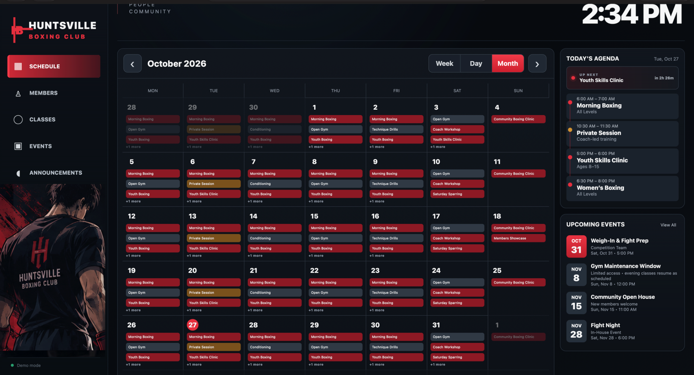
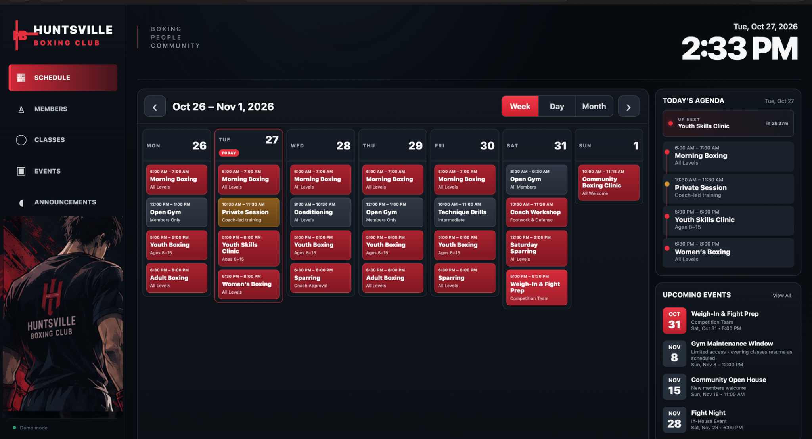
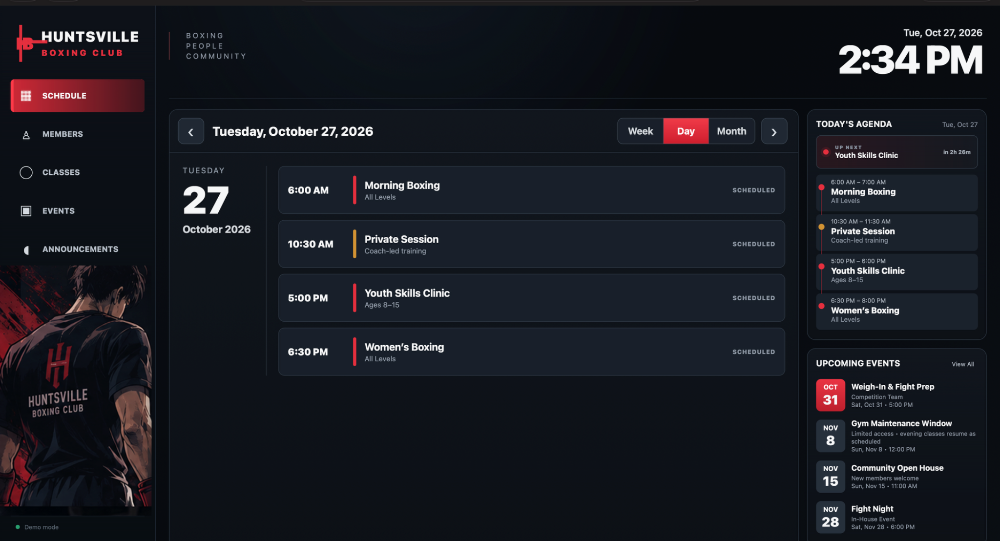
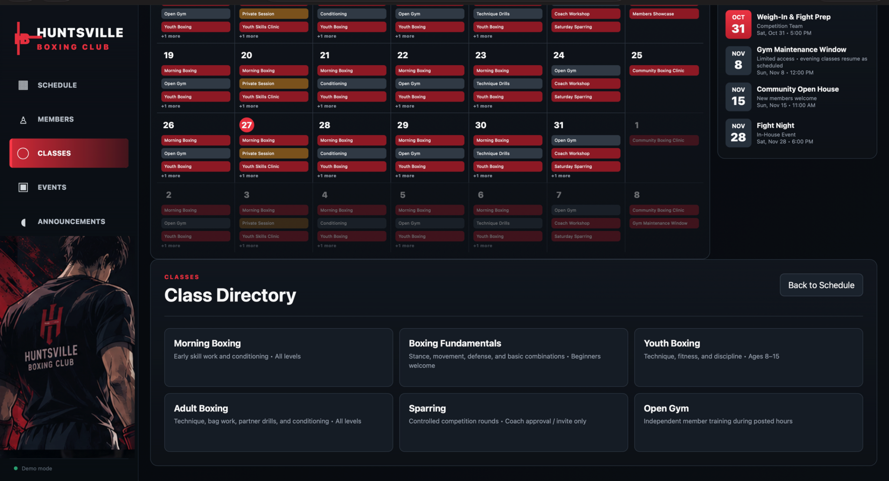
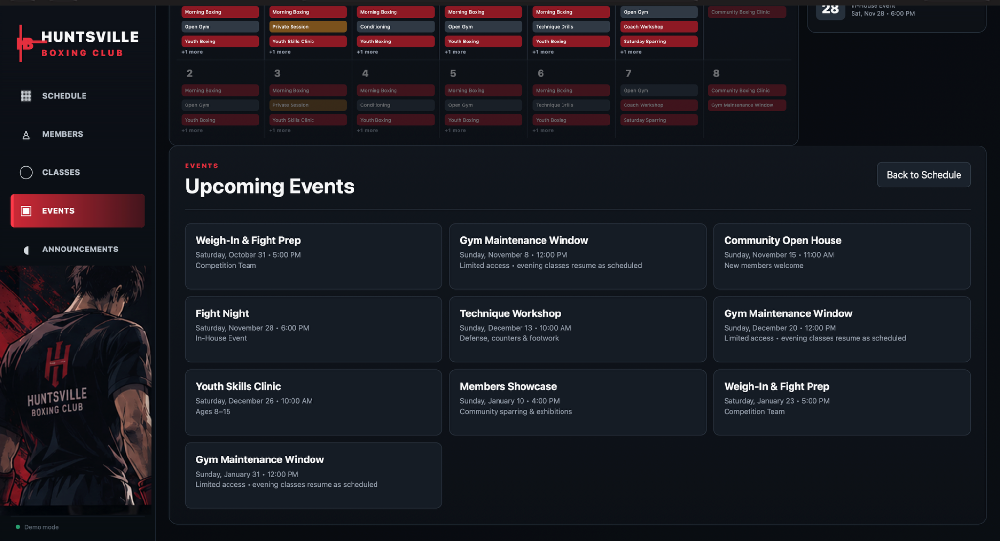

# Huntsville Boxing Club Digital Calendar

A full-stack digital scheduling dashboard built for **Huntsville Boxing Club**, a local boxing gym in Huntsville, Texas.

The project was designed around direct client feedback for a large interactive gym display. It gives athletes, coaches, and visitors a quick view of the weekly schedule, today's classes, upcoming events, and what is happening next without requiring staff to manually maintain a separate display system.

**Live Demo:** https://huntsville-boxing-calendar.vercel.app

> The public deployment uses realistic sample data. The gym's private schedule and Google credentials are not included in this repository.

## Live Demo

[Open the live Huntsville Boxing Club calendar](https://huntsville-boxing-calendar.vercel.app)

### Month View



### Week View



### Day View



## What I Built

- Responsive Week, Day, and Month calendar views
- Today's Agenda panel
- Upcoming Events panel
- **LIVE NOW / UP NEXT** class awareness based on the current time
- Class directory and program information
- Event and announcement views
- Automatic schedule refresh
- Rolling sample schedule for the public demo
- Local fallback for temporary API/network failures
- Stale-data warnings when cached schedule information becomes old
- Production Google Calendar adapter with server-side credentials
- Health endpoint and bounded event-query validation
- Automated tests and GitHub Actions CI
- Subtle animated boxer artwork with reduced-motion support
- Kiosk-oriented layout for a large gym display

## Why I Built It

The goal was not just to make another calendar UI. Huntsville Boxing Club needed something that could work as a **real information display inside the gym**.

The application was designed so the final production version can use Google Calendar as the schedule source. That allows the coach to update classes through a familiar tool instead of learning a custom admin dashboard.

The public version stays in demo mode so recruiters and portfolio visitors can explore the interface without exposing private gym data.

## Tech Stack

### Frontend
- HTML5
- CSS3
- Vanilla JavaScript
- ES modules

### Backend
- Node.js
- Express.js

### Integration
- Google Calendar API architecture
- REST/JSON API

### Reliability & Security
- Helmet / Content Security Policy
- Server-side environment credentials
- Read-only Calendar access design
- Input/date-range validation
- Automatic polling
- Local last-known schedule caching
- Stale-data warnings
- Network-first service-worker app-shell fallback
- Compression middleware

### Testing & Deployment
- Node.js built-in test runner
- JavaScript syntax checks
- GitHub Actions CI
- Vercel public demo deployment

## Architecture

```text
                    PUBLIC DEMO

            Rolling Sample Event Data
                      |
                      v
              Node.js + Express
                      |
               Normalized JSON
                      |
                      v
           Vanilla JavaScript UI
                      |
        +-------------+-------------+
        |             |             |
      Week           Day          Month
        |
        +--> Today's Agenda
        +--> Upcoming Events
        +--> LIVE NOW / UP NEXT


                   PRODUCTION DESIGN

          Huntsville Boxing Club
              Google Calendar
                      |
                      v
             Google Calendar API
                      |
                      v
              Node.js + Express
                      |
               Normalized JSON
                      |
                      v
               Gym Display UI
```

The frontend receives the same normalized event structure whether the application is using sample events or Google Calendar. This keeps the rendering layer independent from the event source.

## Project Structure

```text
huntsville-boxing-calendar/
├── .github/
│   └── workflows/
│       └── ci.yml
├── docs/
│   ├── screenshots/
│   ├── DEMO_DEPLOYMENT.md
│   ├── GITHUB_PUBLISHING.md
│   └── LINKEDIN_PORTFOLIO.md
├── public/
│   ├── assets/
│   │   └── anime-boxer.png
│   ├── js/
│   │   ├── api.js
│   │   ├── app.js
│   │   ├── renderer.js
│   │   ├── state.js
│   │   └── utils.js
│   ├── index.html
│   ├── styles.css
│   └── sw.js
├── src/
│   ├── calendarEvent.js
│   ├── config.js
│   ├── dateRange.js
│   ├── demoEvents.js
│   └── googleCalendar.js
├── test/
├── ARCHITECTURE.md
├── KIOSK_SETUP.md
├── RELEASE_CHECKLIST.md
├── package.json
└── server.js
```

## Running Locally

Requires Node.js 20+.

```bash
npm install
cp .env.example .env
npm run dev
```

Open:

```text
http://localhost:3000
```

For the public/demo version:

```env
DEMO_MODE=true
```

This is a full-stack application, so it should be run through the Node/Express server rather than VS Code Live Server.

## Quality Checks

Run the full local verification suite:

```bash
npm run ci
```

Or run the checks separately:

```bash
npm run check
npm test
```

## Google Calendar Production Design

The intended gym deployment uses a dedicated **Huntsville Boxing Club** Google Calendar rather than the coach's personal primary calendar.

Production configuration is supplied through server-side environment variables:

```env
DEMO_MODE=false
GOOGLE_CALENDAR_ID=...
GOOGLE_CLIENT_EMAIL=...
GOOGLE_PRIVATE_KEY=...
```

Credentials are intentionally excluded from source control.

## Reliability Decisions

Because the application is intended for an always-visible gym display, reliability was treated as part of the product design.

- The browser refreshes schedule data automatically.
- The most recent successful schedule is cached locally.
- Temporary API or network failures do not immediately blank the display.
- Cached data shows its age and warns when it may be stale.
- The production service worker uses network-first behavior so connected displays receive current assets while maintaining an offline fallback.
- Missing static assets return real HTTP 404 responses instead of silently returning the application shell.

## Interface Details

The left-side boxer is part of the Huntsville Boxing Club visual identity for this project. It includes subtle idle movement and an occasional boxing feint while respecting the browser's `prefers-reduced-motion` accessibility setting.

Additional screens include:





## Current Status

### Completed
- Client-approved interface direction
- Full Week / Day / Month experience
- Rolling public demo data
- Live public deployment
- Reliability and fallback behavior
- Google Calendar production adapter
- Automated tests and CI
- GitHub portfolio repository

### Next
- Connect the dedicated gym Google Calendar
- Test the production version on the gym's interactive display
- Complete final client acceptance testing

The application will only be described as **deployed at the gym** after the real calendar connection and physical display acceptance test are complete.
